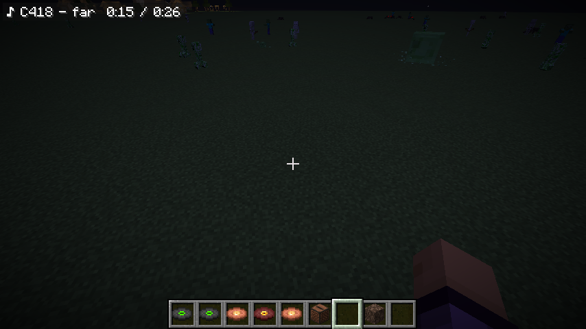
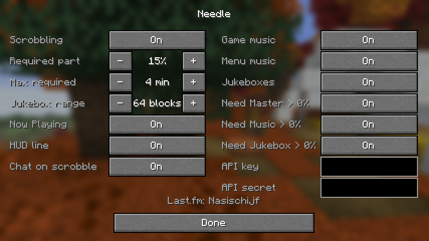

# Needle

Client-side Last.fm scrobbler for Minecraft 26.3 (Fabric). Scrobbles the game's own music and the
music discs you play in jukeboxes, counting only the time you actually hear a track. Works in
singleplayer and on any server; no server mod.



## Use

1. Install Fabric API (Mod Menu is optional).
2. In a world, run `/needle login`, click the link, and allow access on last.fm.
3. Play. A track is scrobbled once you have heard half of it (at most 4 minutes), Last.fm's own rule.

- `/needle status` shows your login, the queue and every track being counted.
- `/needle config` or Mod Menu → Configure opens the settings screen.
- `/needle pause` / `/needle resume`, `/needle flush` (send queued scrobbles now),
  `/needle reload` (re-read the config file), `/needle logout`.

## What counts

- **Only what you hear.** Game music counts while the Master and Music sliders are above 0%. A jukebox
  counts while you are within 64 blocks (configurable), the Master and Jukebox/Note Blocks sliders are
  above 0%, and the game is not paused.
- **One track at a time.** When several things play, the nearest jukebox you can hear gets the time;
  game music only counts when no jukebox is in range. Walk away and come back while the song is still
  playing and its count continues.
- **Built-in tracks only.** All 92 tracks of 26.3 (C418, Lena Raine, Kumi Tanioka, Aaron Cherof, Amos
  Roddy, fingerspit and more), with album names for 90 of them. Data-pack discs, music from other mods
  and tracks a resource pack replaces are not scrobbled.
- A jukebox that started before you came near is not counted: the game does not play it to you either.
- Tracks of 30 seconds or less are never scrobbled (Last.fm rejects them).
- Scrobbles wait in a queue while you are offline and are sent later.

## Settings

All files are in `config/needle/`: `config.json` (settings), `session.json` (your Last.fm login; keep
it private), `queue.json` (scrobbles not sent yet).

| Setting | Default | |
| --- | --- | --- |
| `enabled` | `true` | Master switch |
| `fraction` | `0.5` | Part of a track you must hear (0.1–1.0) |
| `maxRequiredMinutes` | `4` | Cap on the time needed; 0 = no cap |
| `listenRadius` | `64` | Jukebox distance in blocks (1–64) |
| `scrobbleGameMusic`, `scrobbleMenuMusic`, `scrobbleJukebox` | `true` | Sources |
| `requireMasterVolume`, `requireMusicVolume`, `requireJukeboxVolume` | `true` | Slider must be above 0% |
| `sendNowPlaying` | `true` | Show the track as Now Playing on Last.fm |
| `showHud` | `false` | Top-left line with the counted track and progress |
| `chatOnScrobble` | `false` | Chat message per scrobble |
| `apiKey`, `apiSecret` | empty | Your own Last.fm API key, replacing the built-in one |



## Privacy

Needle only talks to Last.fm (`https://ws.audioscrobbler.com/2.0/`), and only after you log in. It sends
artist, title, album, start time and length of the tracks it scrobbles or shows as Now Playing, and
whether the track came from a jukebox. Nothing else: no world, server, chat or player data, no
telemetry.

## Build

Needs JDK 25. The Last.fm API key is not in the repository: put your own in
`~/.gradle/gradle.properties` and it is compiled into the jar (left out of the sources jar).

```
lastfm.apiKey=...
lastfm.apiSecret=...
```

```
./gradlew build          # jar in build/libs, runs the JUnit tests
./gradlew runClient
```

Without these properties the jar has no built-in key, and players must set `apiKey` and `apiSecret`
themselves.

### Scripted in-game checks

`./run-scenario.sh <name>` starts the dev client, runs one scenario and prints `CHECK PASS` /
`CHECK FAIL` lines. Singleplayer scenarios use the world `needletest` in `run/saves`:

```
./run-scenario.sh rules --args="--quickPlaySingleplayer needletest"     # pause, muting, Now Playing, dimensions
./run-scenario.sh pack --args="--quickPlaySingleplayer needletest"      # resource pack replacing a disc
./run-scenario.sh offline --args="--quickPlaySingleplayer needletest"   # queue and retry
./run-scenario.sh 1 --args="--quickPlaySingleplayer needletest"         # two jukeboxes, focus and resume
./run-scenario.sh screen                                                # settings screen
./gradlew runServer --args=nogui                                        # then, in another shell:
./run-scenario.sh server --args="--username NeedleTester --quickPlayMultiplayer localhost:25565"
```

These scrobble to the logged-in Last.fm account. See [SPEC.md](SPEC.md) for the design and limits.

## License

MIT
